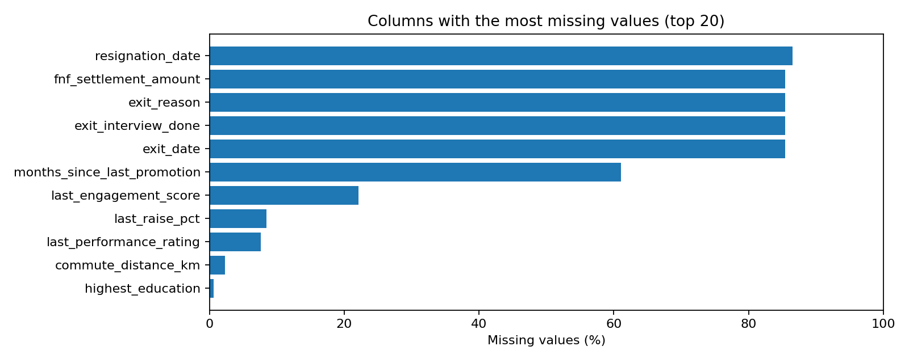
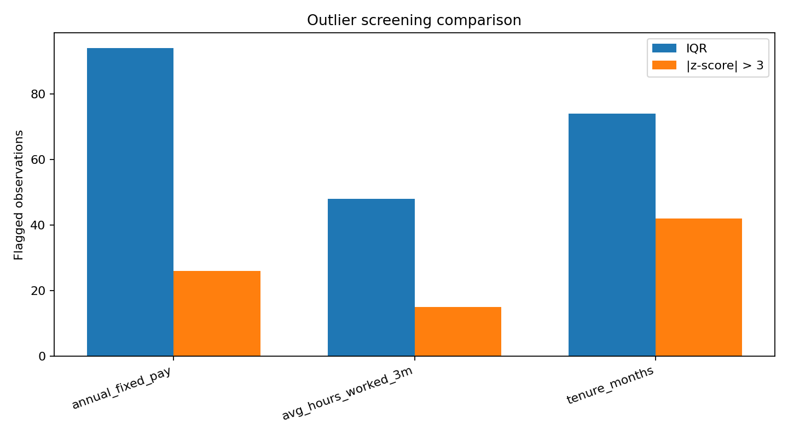
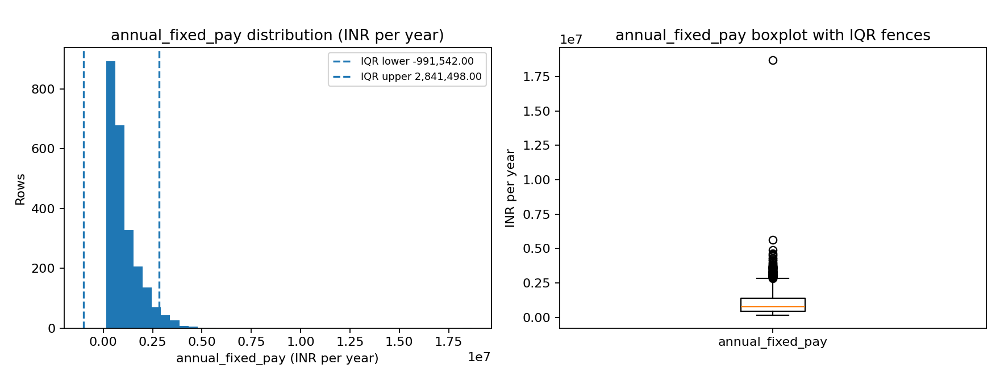
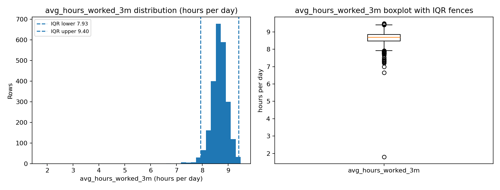
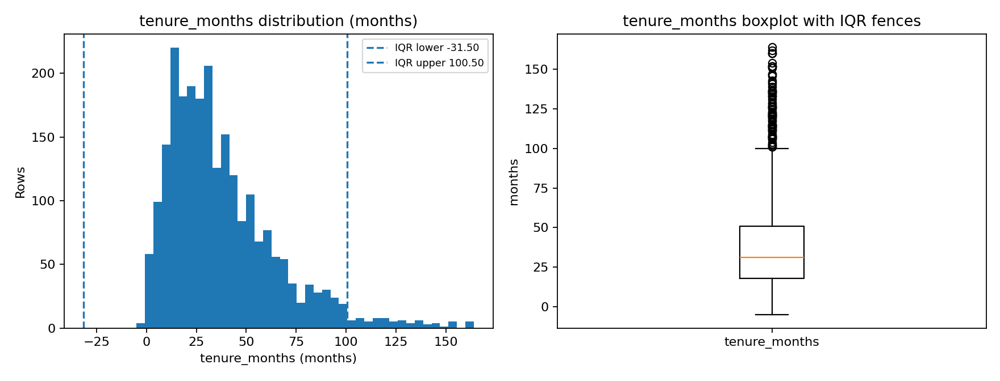
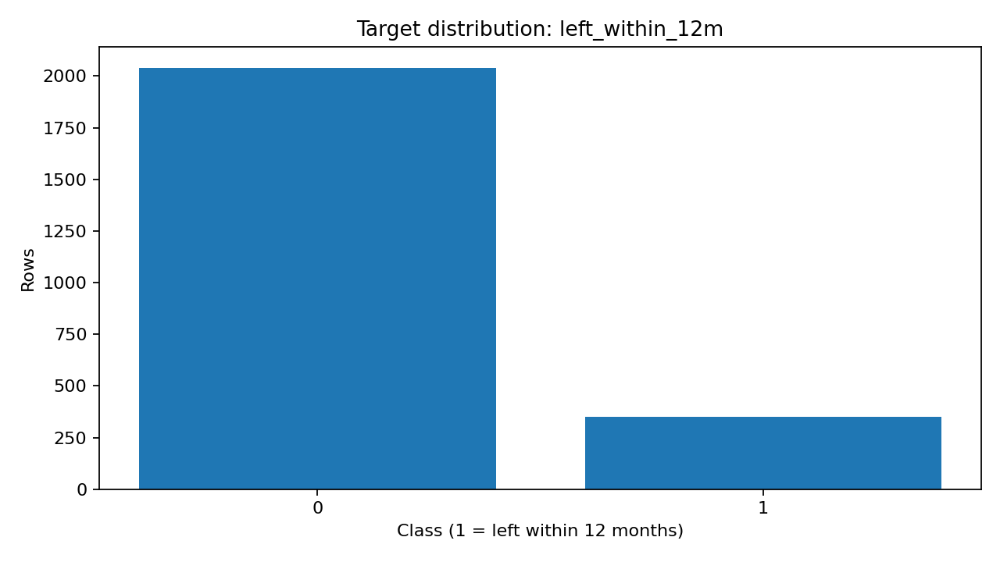

# Aura Workforce — Task 1: Data Audit and Exploration

**Source:** `CortexHR_AI_ML_Dataset.xlsx` · **Worksheet:** `attrition_dataset` only · **Rows:** 2,389 · **Columns:** 42

> Plain-language summary of measured findings. Supporting evidence lives in the CSV files and charts beside this report. No employee-level records are disclosed and the workbook was not modified.

## 1. Dataset overview

Each row is one employee observed on one observation date; the label records whether that person left during the following 12 months (meaning inferred from column patterns — please confirm). Only `attrition_dataset` was read explicitly; links were not opened and the answer key stayed sealed during the independent audit (see the validation appendix for the later authorized comparison). The sheet holds 42 columns: employee attributes, work patterns, two ID columns, the label, and five post-outcome fields. Full inventory: `column_profile.csv`, `data_dictionary.csv`.

## 2. Executive summary

We inspected 2,389 employee records across 42 columns. The headline issues: (a) exit and settlement fields exist only for leavers and must never be model inputs — that is **data leakage**, using information unavailable at prediction time; (b) some gaps are meaningful (no promotion or raise yet) while others need filling in Task 2; (c) pay is skewed with a few typo-like extremes, plus small counts of impossible negatives and out-of-range shares needing source checks; (d) location spellings vary and a few records repeat under a fresh technical ID. Our decisions below handle each case. Subject to them — exclusions, train-only imputation, location mapping and timeline-aware dedup — the data can proceed to Task 2. An **outlier** here means "worth investigating", not "definitely wrong".

## 3. Missing values and decisions

Gaps cluster in a few columns rather than spreading everywhere. "Impute" means filling blanks with a typical value learned from training data; a "was-missing flag" is an extra yes/no column recording that the value was absent, so the model can learn when absence itself matters.

| Column(s) | Missing | Decision |
|---|---:|---|
| Exit and settlement fields (5 post-outcome columns) | 85.4–86.6% | Not predictors — excluded (see leakage) |
| `months_since_last_promotion` | 1,459 (61.07%) | Meaningful gap (no promotion yet) — keep plus flag |
| `last_engagement_score` | 528 (22.10%) | Fill in Task 2 + flag; check source |
| `last_raise_pct` | 202 (8.46%) | Meaningful gap (no raise yet) — keep plus flag |
| `last_performance_rating` | 182 (7.62%) | Fill in Task 2 |
| `commute_distance_km` | 55 (2.30%) | Fill in Task 2 |
| `highest_education` | 15 (0.63%) | Fill in Task 2 |

Post-outcome gaps (~85% blank because stayers have no exit data) are excluded as features, not filled. Structural gaps (no promotion/raise yet) are kept with a was-missing flag, since absence carries meaning. Ordinary gaps (engagement, performance, commute, education) are filled in Task 2 using training-data statistics, with an extra flag for engagement at 22%. No rows are dropped for missing features. Full inventory: `missing_values.csv`.

### Think for yourself: What should we do when a column has 40% missing values?

Do not drop it, fill it, or flag it on the percentage alone — first ask what the column means, why values are missing, whether it will exist when real predictions are made, and whether it helps. If it is a valid, useful predictor, our proposal is: **keep it, add a `was_missing` flag where justified, and fill blanks with a method fitted on training data only** (for example the median for numbers, the most common value for categories). If the gap itself is meaningful — as with "no promotion yet" — preserve that meaning instead of averaging it away. Drop the column only for a documented reason: it reveals the future outcome, will not exist at prediction time, is unreliable, or adds too little to justify itself. Note this 40% case is hypothetical — no column in this dataset sits at exactly 40% (ours jump from 22% to 61%), so treat this as the general rule behind decisions D01–D03.

## 4. Outlier comparison

Two screens ran on `annual_fixed_pay` (pay/year), `avg_hours_worked_3m` (hours/day) and `tenure_months` (months). The IQR rule flags values far outside the middle half of the data; the z-score flags values unusually far from the average relative to spread. They disagree most when data is skewed: a long pay tail inflates the average and spread, so z-score stays quiet while IQR speaks up.

| Variable | IQR flags | Z-score flags |
|---|---:|---:|
| `annual_fixed_pay` | 94 (3.9%) | 26 (1.1%) |
| `avg_hours_worked_3m` | 48 (2.0%) | 15 (0.6%) |
| `tenure_months` | 74 (3.1%) | 42 (1.8%) |

Pay flags are mostly legitimate high earners; hours cluster near 8.7 with one implausible ~1.8-hour value; tenure includes four impossible negatives. A flag means "investigate", never automatic deletion — the four negatives and similar rule-breakers are **suspected data errors**, the rest are ordinary statistical extremes. Every flagged record, with thresholds, direction and business-range verdict, is in `outlier_details.csv`.

  

## 5. Attrition and class imbalance

Our working target is `left_within_12m`: 1 means the employee left within 12 months after the observation date. 349 of 2,389 employees left (14.61%); 2,040 stayed. Roughly one in seven employees left. A model that always predicts 'stayed' would look about 85.4% accurate while finding zero leavers — so accuracy alone would mislead us, and later evaluation must use recall, precision and ranking quality with stratified splits. `left_within_12m` was our working target at audit time; the project owner has since confirmed it as the Task 3 target.

## 6. Data leakage

Leakage means letting the model peek at information that reveals the answer or would not exist yet when predicting. The confirmed post-outcome fields — `exit_date`, `resignation_date`, `exit_reason`, `exit_interview_done`, `fnf_settlement_amount` — are recorded only for leavers and must be excluded from inputs. Identifiers (`row_id`, `employee_id`) are excluded for privacy and because they cannot generalize, and the alternate outcome label is excluded since it describes the same event. All 42 columns were reviewed one by one; the full register is in `leakage_register.csv`.

## 7. Data-quality findings and decisions

- Duplicates: 0 full-row match(es), but 6 extra row(s) in 6 group(s) once the technical `row_id` is set aside — copies with a fresh ID hide from full-row comparison. Task 2 dedups on the business key (D08).
- Negative tenure: 4 (0.17%) rows — impossible; verify against HR, quarantine (D09, confirmed).
- Negative experience: 10 (0.42%) rows — verify source, flag (D09, provisional).
- Work-from-home share below 0: 190 (7.95%) rows; above 1: 23 (0.96%) rows — needs definition check before any use (D09, requires confirmation).
- Attendance above 1.0: 2 (0.08%) rows — confirm definition, flag rows (D09).
- Implausible hours: 1 (0.04%) row — investigate the extreme, keep the rest (D04).
- Pay-vs-ratio inconsistency: 3 (0.13%) rows — matches decimal-place-typo pattern; verify against payroll, never auto-correct (D04/D09, provisional).
- Location variants: 13 (0.54%) rows — normalize with the HR-approved mapping in Task 2 (D09).
- Resignation before observation: 41 (12.77%) of dated cases — clarify dating before any date feature (D10).
- No non-positive pay found — a good sign. Record-level evidence: `data_quality_issue_details.csv`, `duplicate_review.csv`, `invalid_values.csv`.

| ID | Area | Action | Why | Task 2 rule | Status |
|---|---|---|---|---|---|
| D01 | missingness | Preserve structural missingness for months_since_last_promotion and last_raise_pct; add missingness indicators in Task 2 | These fields are missing exactly when no promotion/raise occurred, so absence carries meaning. | Impute only for modelling convenience (e.g. large sentinel) AND keep is_never_promoted / is_never_raised flags; fit on train only. | Binding Task 2 rule |
| D02 | missingness | Impute commute_distance_km, last_performance_rating, highest_education with train-fitted imputers; investigate engagement missingness | Low-to-moderate missingness (0.6-7.6%) without structural pattern; engagement at 22% needs source check. | Median/mode imputation fitted on train; add missingness indicator for engagement; document rates. | Binding Task 2 rule |
| D03 | missingness | Do not drop any column for missingness alone; never drop rows except for missing target | Even 61% and 85% missing columns have business meaning (no-event vs post-event). | Keep columns through Task 2 design; drop rows only if the target label itself were missing. | Binding Task 2 rule |
| D04 | outliers | Retain all statistical outliers through Task 1; flag and investigate before any Task 2 treatment | IQR and z-score flag legitimate extremes in skewed pay/hours/tenure data. | No deletion/capping in audit; in Task 2 prefer robust scaling and flagged-indicator columns; cap only with documented HR limits. | Binding Task 2 rule |
| D05 | target | Use left_within_12m as the Task 3 label (confirmed by project owner; working target at audit time) | Binary 0/1 field with documented leaver meaning; class imbalance requires stratified handling. | Stratified splits; report precision/recall/AUC rather than accuracy alone. | Confirmed by project owner |
| D06 | leakage | Exclude all post-outcome exit/settlement fields from model inputs | These fields exist only after leaving and would not be known at prediction time. | Drop exit_date, resignation_date, exit_reason, exit_interview_done, fnf_settlement_amount before training. | Binding Task 2 rule (exclude) |
| D07 | leakage | Exclude identifiers and the non-primary outcome label from features | IDs harm generalization and privacy; the second label reveals the same event. | Drop row_id/employee_id and the alternative target column from X. | Binding Task 2 rule (exclude) |
| D08 | duplicates | Keep all rows in Task 1; resolve repeated employee identifiers in Task 2 with a documented key rule | No full-row duplicates, but business-record duplicates exist once the technical row_id is excluded; repeated employee IDs need timeline-aware dedup, not deletion. | Define one-row-per-employee rule (e.g. latest observation; business key = all fields except row_id) before modelling; keep audit trail. | Binding Task 2 rule |
| D09 | data-quality | Standardize work_location spellings and validate impossible ranges in Task 2 | Case/city variants fragment categories; negatives and out-of-range shares are data errors until proven otherwise. | Recorded category mapping; range checks with quarantine/flag, not silent deletion. | Provisional - HR confirmation needed |
| D10 | temporal | Confirm observation/prediction timestamp and prior-window definitions before modelling | Leakage decisions depend on what is known at prediction time. | Freeze prediction date; verify dept prior rate window ends at observation; time-based validation split. | Provisional - source confirmation needed |

## 8. Handoff to Task 2

The table above is the handoff: Task 2 must implement these rules in a reusable, versioned pipeline — missing-value handling with was-missing flags, leakage exclusions, outlier/invalid handling with robust scaling and quarantine, business-key dedup, approved location mapping — fitting every learned step (imputers, scalers, encoders) on training data only and applying it unchanged to validation, test and future data. Task 2 itself is not built here.

## 9. Open questions

Target confirmation — resolved (`left_within_12m` confirmed by the project owner for Task 3); canonical location list; causes of negatives, out-of-range shares, attendance above 1 and pre-observation resignations; department prior-rate window; whether engagement gaps are systematic; `comp_ratio` definition. All need HR/source confirmation.

## Post-Audit Validation Against Planted Issues

The independent audit above was completed before the planted answer key (`answer_key_planted_dirt`) was read. This section compares that independent assessment against the planted issues afterwards. Original findings are unchanged; corrections made because of validation are listed explicitly below.

| Issue category | Expected | Detected | Matched | Missed | Status |
|---|---:|---:|---:|---:|---|
| missing_commute_distance | 55 | 55 | 55 | 0 | detected |
| missing_highest_education | 15 | 15 | 15 | 0 | detected |
| inconsistent_work_location | 13 | 13 | 13 | 0 | detected |
| salary_typo_10x | 3 | 3 | 3 | 0 | detected-after-correction |
| impossible_attendance_gt_1 | 2 | 2 | 2 | 0 | detected |
| negative_tenure | 4 | 4 | 4 | 0 | detected |
| duplicate_records | 6 | 6 | 6 | 0 | detected-after-correction |

Full aggregate table: `planted_issue_validation.csv` (no employee-level data).

- **missing_commute_distance**: Planted 55; audit measured 55 (2.30%). Matched 55, missed 0. Measured 55/2389 = 2.30% on the full sheet vs the key's '2.8%': the key's figure is consistent with a 2000-row historical-batch denominator (55/2000 = 2.75% ~ 2.8%), while this sheet also holds snapshot rows and 5 of the 55 blanks fall outside that batch (50/2000 = 2.50% within it). The report's 2.30% is correct for all rows.
- **missing_highest_education**: Planted 15; audit measured 15 (0.63%). Matched 15, missed 0.
- **inconsistent_work_location**: Planted 13 across 7 variants; audit flagged 13 (BENGALURU=3, Bangalore=3, Delhi-NCR=1, Madras=1, bengaluru=2, chennai=2, delhi ncr=1). Matched 13. Variants are formatting/case differences plus one alternate name (Madras for Chennai); canonicalization in Task 2 is justified for these, not a blanket rule for every distinct string.
- **salary_typo_10x**: Planted 3. Initial audit caught 3/3 only as generic statistical outliers (IQR 94, z 26) without identifying the pay-vs-ratio inconsistency. Post-validation correction adds a specific check: pay-implied reference (pay/comp_ratio) vs the job-level median; 3 rows exceed 3.0x with no other rows above 2x. Never auto-correct values.
- **impossible_attendance_gt_1**: Planted 2; audit invalid-value check found 2. Decision register D09 quarantines/flags out-of-range shares for Task 2.
- **negative_tenure**: Planted 4; audit found 4. No join-date column exists in the sheet, so the observation-date-vs-join-date relationship cannot be confirmed from available information.
- **duplicate_records**: Planted 6 appended copies. Full-row duplicates: 0 (copies carry a fresh row_id, so the initial '0 exact duplicates' statement was technically correct but incomplete). Business-record duplicates excluding row_id: 6 extra rows in 6 groups, matching all 6 planted cases. Initial audit noted 6 repeated employee IDs but did not run the business-field comparison; added post-validation. Repeated IDs alone were rightly not treated as proof.

*Artifacts: `column_profile.csv`, `data_dictionary.csv`, `missing_values.csv`, `outlier_summary.csv`, `target_distribution.csv`, `leakage_register.csv`, `decision_register.csv`, `duplicate_review.csv`, `invalid_values.csv`, `planted_issue_validation.csv` (after validation), `audit_summary.md`, `figures/`.*
*Record-level detail files (`outlier_details.csv`, `data_quality_issue_details.csv`) are generated locally alongside this report and intentionally excluded from version control.*
