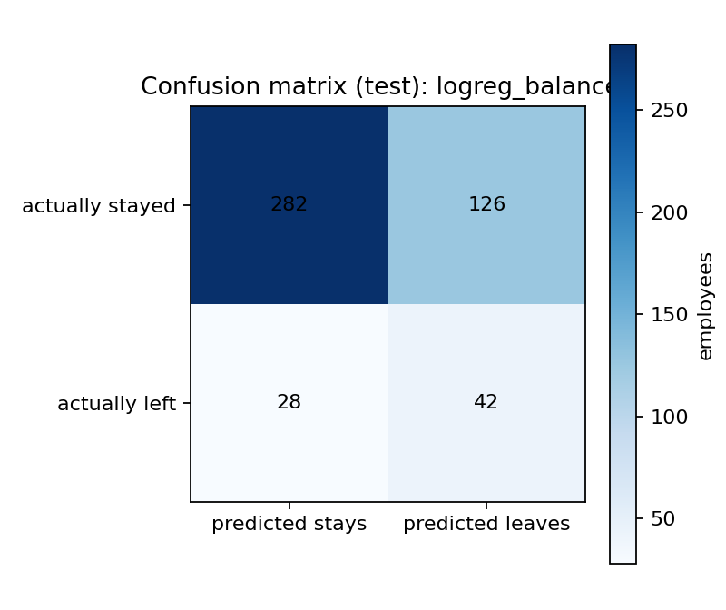
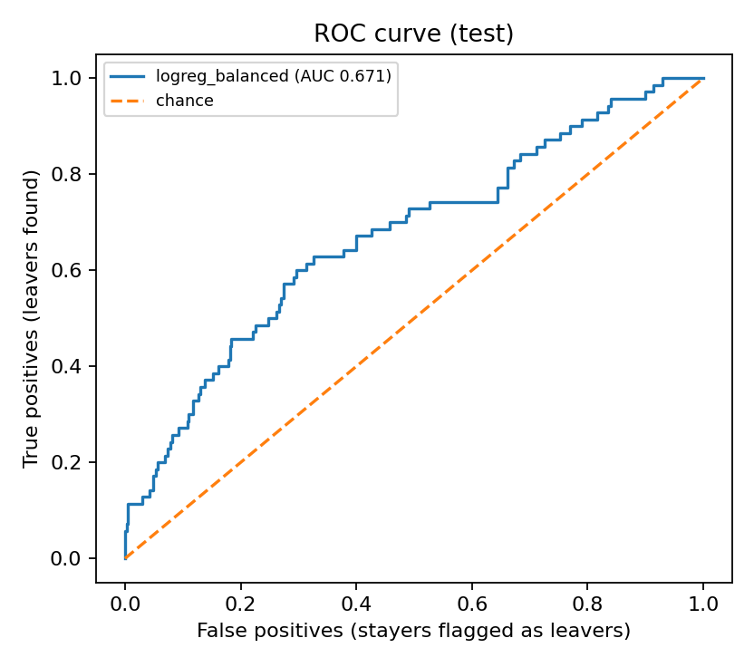
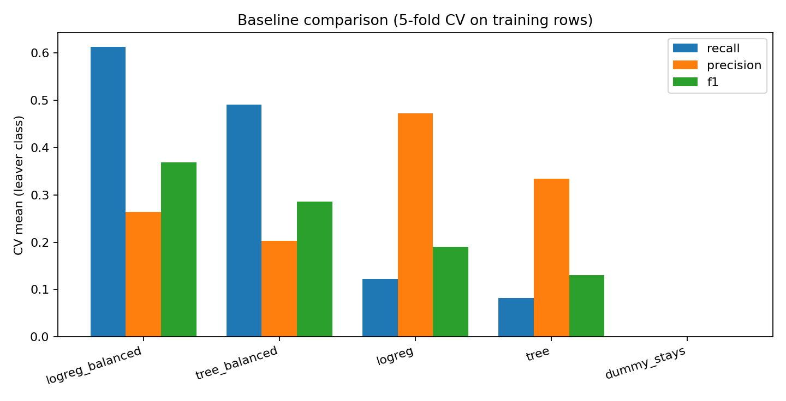

# Aura Workforce: Task 3 Baseline Report

**Task:** Attrition Baseline Models and Evaluation  
**Question:** How well can simple, reproducible models identify employees who leave within 12 months?

## What was tested

Compared five starting models:
- A simple model that always predicts “stayed.”
- Logistic regression, which estimates the chance that an employee leaves.
- The same logistic regression with extra weight given to leavers.
- A shallow decision tree, which makes predictions using a small set of decision rules.
- The same shallow tree with extra weight given to leavers.

 Used the confirmed target `left_within_12m`: `1` means left within 12 months and `0` means stayed. The dataset contains 349 leavers and 2,040 stayers, so leavers are the smaller group.

## How the comparison kept fair

 Reused the existing split from Task 2: 1,911 rows for training and 478 rows kept aside for final testing. The split uses seed 42.

 Compared models using five rounds of cross-validation on the training data only. In each round, one part of the training data was used to check a model while the other parts were used to fit it. The filling, scaling and category-handling steps were fitted again inside each round, using only that round's training records.

 Chosed the model using cross-validation results before looking at the held-out test results. The test set was evaluated at the end, with the classification threshold fixed at 0.5.

## What the measures mean

- **Recall:** Of all employees who actually left, how many did the model identify?
- **Precision:** Of everyone the model flagged as a possible leaver, how many actually left?
- **F1:** A combined measure that balances precision and recall.
- **ROC-AUC:** How well the model generally ranks leavers above stayers. A score near 0.5 is no better than chance for ranking; higher is better.
- **Accuracy:** The share of all predictions that were correct. It can be misleading when one group is much larger than the other.

Because HR's stated priority is to catch more leavers, recall was the main model-selection measure. Precision was still monitored because many false alarms can waste HR time.

## Cross-validation results

These are the average results across the five training-only validation rounds. The ± value is the variation, measured as standard deviation, between rounds.

| Model | Recall | Precision | F1 | ROC-AUC |
|---|---:|---:|---:|---:|
| Logistic regression with class weighting | 0.613 ± 0.060 | 0.264 ± 0.024 | 0.368 ± 0.032 | 0.714 ± 0.047 |
| Shallow tree with class weighting | 0.491 ± 0.077 | 0.203 ± 0.045 | 0.286 ± 0.051 | 0.607 ± 0.035 |
| Plain logistic regression | 0.122 ± 0.056 | 0.472 ± 0.183 | 0.190 ± 0.080 | 0.712 ± 0.047 |
| Plain shallow tree | 0.082 ± 0.033 | 0.335 ± 0.088 | 0.130 ± 0.044 | 0.656 ± 0.036 |
| Always predict “stayed” | 0.000 ± 0.000 | 0.000 ± 0.000 | 0.000 ± 0.000 | 0.500 ± 0.000 |

Class weighting helped the models identify more leavers, but it also increased false alarms. For example, balanced logistic regression raised recall substantially compared with plain logistic regression, while precision fell. Its ranking performance, measured by ROC-AUC, changed very little.

## Final check on the held-out test set

After selecting the model using cross-validation, we evaluated the candidates on the test set. These final results were not used to choose the model.

| Model | Accuracy | Precision | Recall | F1 | ROC-AUC |
|---|---:|---:|---:|---:|---:|
| Always predict “stayed” | 0.854 | 0.000 | 0.000 | 0.000 | 0.500 |
| Plain logistic regression | 0.847 | 0.412 | 0.100 | 0.161 | 0.676 |
| Balanced logistic regression | 0.678 | 0.250 | 0.600 | 0.353 | 0.671 |
| Plain shallow tree | 0.841 | 0.385 | 0.143 | 0.208 | 0.670 |
| Balanced shallow tree | 0.722 | 0.260 | 0.486 | 0.338 | 0.618 |

## Recommended starting model

We selected **balanced logistic regression** because it had the highest average recall across the training cross-validation rounds under the stated selection rule.

On the held-out test set, it found 42 of the 70 actual leavers. It missed 28 leavers and incorrectly flagged 126 people who stayed. Its recall was 60%, precision was 25%, and ROC-AUC was 0.671.

In practical terms, it found more leavers than the plain models, but its false-alarm burden is substantial. HR would need to treat its flags as prompts for careful review, not as proof that someone will leave.

The dummy model illustrates why accuracy alone is not enough: it was about 85.4% accurate simply by predicting that everyone stayed, but it identified no leavers.

## Limits of these results

These are baseline models, not a finished HR decision system. The results depend on the supplied data, the chosen split, the available features and the fixed 0.5 threshold. The model does not prove why an employee might leave. The project owner confirmed `left_within_12m` as the Task 3 target; the alternate voluntary-leaving label was not substituted.

Later models should be compared against these baselines using the same split discipline and leakage protections. Cross-validation figures and final test figures must remain clearly separated.

## Reproducibility

The report and supporting files are generated by the Task 3 baseline workflow. The cross-validation fold results, summary table, model settings, final held-out metrics, selected configuration, confusion matrix and ROC curve are saved alongside this report. The fitted baseline artifacts are stored locally under `artifacts/task3/` and should not be treated as raw source data.
