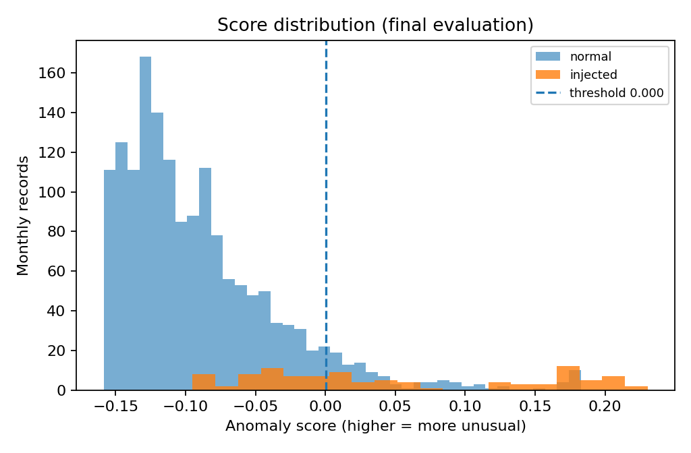
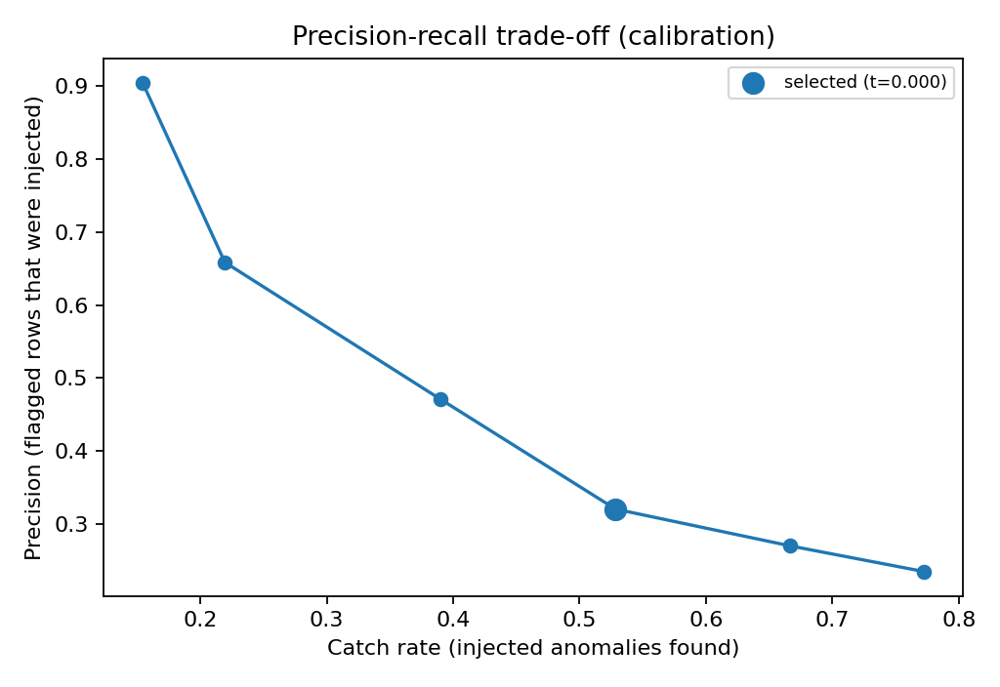

# Aura Workforce: Task 4 Attendance Anomaly Report

**Task:** Attendance Anomaly Detection  
**Purpose:** Identify monthly attendance records that look unusual enough to deserve a closer review.

## What we built

 Trained an Isolation Forest, a method that learns the patterns seen in ordinary attendance records and gives a higher anomaly score to records that look unusual under our scoring convention. The model was trained without being given the injected-anomaly labels.

 Then created controlled examples of three unusual patterns, tested how many the model found, and chose a threshold for raising a flag. This is a baseline experiment, not a production HR monitoring system.

## Data used

The monthly attendance worksheet contains 7,339 employee-month records from April 2025 through September 2026. The payroll table was checked to provide consistent monthly context; confirmed duplicate payroll lines were removed before the one-to-one join. One payroll-only month record was left out of the joined attendance feature set.

The 150 reference labels were used only for context and evaluation-pool handling, not as model inputs. Daily examples helped inform the injection scenarios. The original workbook was not changed.

## The three unusual patterns we tested

| Pattern | How the test example was created |
|---|---|
| Impossible working hours | A monthly hours value was set to between 19 and 22 hours per day. This is an experimental range for testing, not an official HR policy. |
| Long absence | A long unpaid-absence streak was created consistently across the related monthly fields. We do not claim to know the reason for an absence. |
| Sudden change | Attendance was reduced sharply compared with the employee's own earlier pattern, using records with enough past history for a fair comparison. |

The injection script uses fixed seeds, so the same inputs and settings reproduce the same test copies. The original source data is left untouched.

## How trained and tested the detector

 Trained the preprocessing steps and Isolation Forest on normal monthly records from April through December 2025. The calibration period was January through May 2026. The final evaluation period was June through September 2026.

 Used the calibration period to compare possible thresholds. then frozed the chosen threshold before measuring results on the final period. The final period did not determine the threshold.

The chosen threshold is **0.0004**. It was selected using an experimental rule: choose the highest catch rate while keeping the false-alarm rate among normal records at or below 10%, with precision used as a tie-break. This is a working test policy, not an approved HR requirement.

## What the threshold comparison showed

A higher catch rate usually means more real anomalies are found, but it can also mean more normal records are incorrectly flagged.

| Threshold | All records flagged | Injected anomalies caught | Normal records wrongly flagged |
|---|---:|---:|---:|
| 0.1773 | 1.0% | 15% | 0% |
| 0.1635 | 2.0% | 22% | 1% |
| 0.0432 | 5.0% | 39% | 3% |
| **0.0004 (chosen)** | **10.0%** | **53%** | **7%** |
| -0.0292 | 15.0% | 67% | 12% |
| -0.0502 | 20.0% | 77% | 16% |

The false-alarm figure is the share of normal records wrongly flagged, not the share of all records. That difference matters when judging how often HR could receive false alerts.

## Final independent evaluation

The frozen threshold was tested on a separate set containing 102 deliberately injected anomalies and normal records.

| Measure | Final result |
|---|---:|
| Injected anomalies | 102 |
| Anomalies caught | 59 |
| Anomalies missed | 43 |
| Catch rate | 57.8% |
| Normal records wrongly flagged | 111 |
| False-alarm rate among normal records | 7.0% |
| Precision | 34.7% |
| F1-score | 0.434 |
| All records flagged | 10.1% |

The detector caught a little under six out of every ten injected anomalies in this test. It also flagged some normal records, so an alert should prompt investigation rather than be treated as proof of wrongdoing or a policy violation.

The model flagged 10.1% of the final records, below the task's warning about flagging one fifth of records. That does not establish that the same alert rate will hold for every real workforce or future period.

## Saved model and repeatability

The fitted detector and its preprocessing are saved locally as `artifacts/task4/attendance_iforest.joblib`. The accompanying metadata records the features, training period, model settings, scoring convention, selected threshold, evaluation results and random seeds.

The scoring command can reload the saved model and apply it to new compatible monthly records without fitting it again. Detailed injection manifests and row-level scored outputs are generated locally and are intentionally excluded from version control.

## Limits and decisions still needed

- The 19–22 hours range is a test assumption, not an official work-hours rule.
- The absence examples do not establish why an employee was absent.
- History available at the beginning of each data pool is limited, so some trailing calculations have less past context.
- The 10% false-alarm limit is an experimental choice that should be reviewed with HR.
- This test measures performance on the injected patterns. It does not prove that all real attendance anomalies will be detected.
- The detector does not use employee identifiers as model features.

## Connection to later work

The reusable approach carries forward: use consistent monthly features, fit preprocessing on training data only, choose an explicit threshold, record false alarms, and save the model with metadata. A later payroll detector should use payroll-focused features and its own threshold evaluation rather than reusing this attendance threshold without testing.
